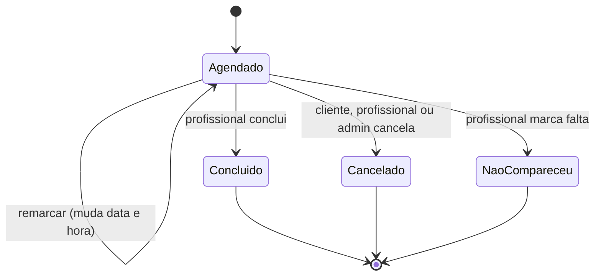

# Wellbook — Documento de Requisitos

> 11/11/2026 · Lucas Terminiello
>
> **Status:** em construção (protótipo acadêmico, SENAI). Os originais deste documento estão em [`documentacao/`](documentacao/) ([PDF](documentacao/Wellbook-Documento-de-Requisitos.pdf) · [DOCX](documentacao/Wellbook-Documento-de-Requisitos.docx)).

## Sumário

1. [Visão geral](#1-visão-geral)
2. [Perfis de usuário e níveis de acesso](#2-perfis-de-usuário-e-níveis-de-acesso)
3. [Requisitos funcionais (RF)](#3-requisitos-funcionais-rf)
4. [Regras de negócio (RN)](#4-regras-de-negócio-rn)
5. [Requisitos não funcionais (RNF)](#5-requisitos-não-funcionais-rnf)
6. [Fluxos principais](#6-fluxos-principais)
7. [Modelo de dados conceitual](#7-modelo-de-dados-conceitual)
8. [Identidade visual e temas](#8-identidade-visual-e-temas)
9. [Fora do escopo e evoluções futuras](#9-fora-do-escopo-e-evoluções-futuras)

---

## 1. Visão geral

Wellbook é uma plataforma SaaS multi-tenant de agendamento e gestão para clínicas de estética e saúde mental. A clínica que originou o levantamento é o primeiro tenant (inquilino).

**Problema de negócio.** A clínica usa um site antigo e pouco intuitivo. O agendamento é feito por WhatsApp e e-mail, sem controle de faturamento nem da divisão de valores entre clínica e profissional.

**Proposta.** Um app (Android e iOS) e uma versão web para desktop, criados do zero. Cada clínica tem seu perfil, seus profissionais, seus serviços e seu tema visual. O cliente final agenda pelo app ou pelo site; o profissional gere a própria agenda; o dono acompanha o faturamento.

**Posicionamento.** Marca de alto padrão, no registro das grifes: relaxamento, calma, alma limpa, beleza e poder. Não promete felicidade nem alegria. Slogan opcional, de no máximo 2 palavras.

**Tipo de entrega.** Documentação de requisitos + aplicação funcional, como protótipo acadêmico (não produção).

**Referência de mercado.** Trinks, usado como referência de fluxo, não de visual.

## 2. Perfis de usuário e níveis de acesso

São quatro perfis. Cada profissional enxerga só os próprios dados; o admin enxerga a clínica inteira, exceto as observações dos clientes.

| Perfil | Quem é | Escopo |
|---|---|---|
| Super Admin | Dono da plataforma Wellbook | Cadastra e ativa/desativa tenants. Não acessa dados operacionais das clínicas |
| Admin do tenant | Dono da clínica | Tudo da sua clínica: profissionais, serviços, comissões, tema, dashboard geral |
| Profissional | Cabeleireiro(a), manicure, esteticista, psicólogo(a), terapeuta | A própria agenda, os próprios serviços e o próprio dashboard |
| Cliente | Quem agenda o atendimento | Os próprios agendamentos, em qualquer clínica que use a Wellbook |

### Matriz de permissões

| Ação | Super Admin | Admin | Profissional | Cliente |
|---|:---:|:---:|:---:|:---:|
| Cadastrar/desativar tenant | Sim | Não | Não | Não |
| Escolher tema e logo da clínica | Não | Sim | Não | Não |
| Cadastrar/excluir profissional | Não | Sim | Não | Não |
| Definir % de repasse do profissional | Não | Sim | Não (só visualiza a sua) | Não |
| Cadastrar/excluir serviço | Não | Sim | Não | Não |
| Definir horários de atendimento | Não | Sim | Sim (só os seus) | Não |
| Agendar | Não | Não | Não | Sim |
| Cancelar/remarcar agendamento | Não | Sim | Sim (só os seus) | Sim (só os seus) |
| Concluir atendimento e registrar valores | Não | Não | Sim (só os seus) | Não |
| Ler observação do cliente | Não | Não | Sim (só do seu atendimento) | Sim (a própria) |
| Dashboard geral da clínica | Não | Sim | Não | Não |
| Dashboard individual | Não | Sim (de qualquer profissional) | Sim (só o seu) | Não |

O dono da clínica pode também atender como profissional: o mesmo usuário acumula os perfis Admin e Profissional no tenant (tabela `membros_tenant`).

## 3. Requisitos funcionais (RF)

São 34 requisitos em 7 módulos. A coluna Perfil indica quem executa a ação.

### Autenticação e conta

| ID | Requisito | Perfil |
|---|---|---|
| RF01 | Cadastro com nome, e-mail, telefone e senha | Cliente |
| RF02 | Login com e-mail e senha | Todos |
| RF03 | Login com Google | Cliente |
| RF04 | Login com Apple (obrigatório pela diretriz 4.8 da App Store) | Cliente |
| RF05 | Recuperação de senha por e-mail | Todos |
| RF06 | Agendar exige estar logado | Cliente |

### Plataforma e tenants

| ID | Requisito | Perfil |
|---|---|---|
| RF07 | Cadastrar, ativar e desativar tenants (clínicas) | Super Admin |
| RF08 | Cada tenant tem uma página pública com link próprio (ex.: wellbook.app/nome-da-clinica) | Sistema |
| RF09 | Escolher 1 tema entre os presets; a mudança vale na hora para app e site do tenant | Admin |
| RF10 | Enviar o logo da clínica | Admin |
| RF11 | O app aplica o tema da clínica que o cliente está acessando | Sistema |

### Profissionais e serviços

| ID | Requisito | Perfil |
|---|---|---|
| RF12 | Cadastrar, editar e excluir profissionais (cabeleireiro(a), manicure, esteticista, psicólogo(a), terapeuta e outros) | Admin |
| RF13 | Definir a % de repasse à clínica individualmente por profissional | Admin |
| RF14 | Cadastrar, editar e excluir serviços com nome, duração e preço | Admin |
| RF15 | Vincular serviços a profissionais (um profissional tem vários serviços) | Admin |
| RF16 | Definir dias e horários de atendimento do profissional | Admin, Profissional |
| RF17 | Bloquear horários (folga, pausa) | Admin, Profissional |

### Agendamento

| ID | Requisito | Perfil |
|---|---|---|
| RF18 | Acessar o perfil da clínica e ver seus profissionais | Cliente |
| RF19 | Escolher o profissional e depois os serviços que ele oferece | Cliente |
| RF20 | Escolher o dia com atalhos Hoje, Amanhã e Escolher data (calendário) | Cliente |
| RF21 | Escolher entre os horários livres do dia, calculados pela duração dos serviços | Cliente |
| RF22 | Escrever uma observação para quem vai atender | Cliente |
| RF23 | Ver, cancelar e remarcar os próprios agendamentos | Cliente |
| RF24 | Ver a própria agenda por dia e por semana | Profissional |
| RF25 | Marcar o cliente como não compareceu | Profissional |

### Conclusão e valores

| ID | Requisito | Perfil |
|---|---|---|
| RF26 | Concluir o atendimento | Profissional |
| RF27 | Ao concluir, registrar valor bruto, desconto ou adicional e forma de pagamento (Pix, dinheiro, cartão) | Profissional |
| RF28 | Calcular automaticamente o valor líquido e a divisão clínica/profissional | Sistema |

### Dashboards e relatórios

| ID | Requisito | Perfil |
|---|---|---|
| RF29 | Dashboard geral: faturamento, agendamentos e repasses da clínica | Admin |
| RF30 | Dashboard individual: agendamentos, serviços, faturamento e comissão do próprio profissional | Profissional |
| RF31 | Filtros por profissional, cliente, serviço e período (o profissional filtra só os próprios dados) | Admin, Profissional |

### Notificações

| ID | Requisito | Perfil |
|---|---|---|
| RF32 | Confirmação de agendamento, cancelamento e remarcação por e-mail e push | Sistema |
| RF33 | Lembrete automático antes do atendimento por e-mail e push | Sistema |
| RF34 | Botão Chamar no WhatsApp (link wa.me, sem custo) | Cliente, Profissional |

## 4. Regras de negócio (RN)

O faturamento só nasce na conclusão do atendimento. O sistema calcula e registra, mas não recebe pagamentos.

| ID | Regra |
|---|---|
| RN01 | O pagamento acontece fora do sistema (presencial ou Pix direto para a clínica/profissional). Sem API de pagamento e sem cálculo de impostos |
| RN02 | Não há cobrança de caução pelo app. Política de sinal é decisão de cada tenant, fora do sistema |
| RN03 | Somente o profissional do atendimento pode concluí-lo |
| RN04 | O valor só é registrado ao concluir o atendimento |
| RN05 | Agendamento cancelado ou com não compareceu não soma no faturamento |
| RN06 | Remarcar não altera valores, pois nada foi registrado antes da conclusão |
| RN07 | Na conclusão são gravados: valor bruto (soma dos preços dos serviços), desconto ou adicional, valor líquido e forma de pagamento |
| RN08 | O preço é copiado no momento da conclusão; mudar o preço de um serviço depois não altera atendimentos já concluídos |
| RN09 | Repasse à clínica = valor líquido × % definida para o profissional; o profissional fica com o restante |
| RN10 | A % de repasse é individual por profissional e só o admin a altera. A % usada fica gravada no atendimento; alterá-la depois não muda o passado |
| RN11 | A observação do cliente é visível apenas ao cliente e ao profissional do atendimento. O admin não tem acesso |
| RN12 | Não é permitido agendar em horário ocupado, bloqueado ou fora do expediente do profissional |
| RN13 | A duração do agendamento é a soma das durações dos serviços escolhidos |
| RN14 | Um profissional pertence a um único tenant; o cliente pode agendar em vários tenants com a mesma conta |
| RN15 | Dados de um tenant nunca são visíveis para outro tenant |

**Exemplo da RN09:** valor bruto R$ 220, desconto R$ 20, líquido R$ 200. Com 30% para a clínica, a clínica fica com R$ 60 e o profissional com R$ 140.

**RN16:** políticas de atendimento são decisão de cada tenant. O prazo mínimo para o cliente cancelar ou remarcar pelo app é configurado pelo admin (padrão: sem prazo mínimo).

## 5. Requisitos não funcionais (RNF)

TypeScript em todas as camadas, com o isolamento entre clínicas garantido no próprio banco.

| ID | Categoria | Requisito |
|---|---|---|
| RNF01 | Plataformas | App para Android e iOS (React Native + Expo) e site para navegador desktop (Next.js) |
| RNF02 | Arquitetura | Monorepo com código compartilhado: tipos, validações (Zod) e regras de cálculo de valores |
| RNF03 | Banco de dados | PostgreSQL com Row Level Security (Supabase), isolando tenants e perfis no banco |
| RNF04 | Segurança | Senhas com hash, autenticação por token, comunicação somente por HTTPS |
| RNF05 | LGPD | Consentimento no cadastro, política de privacidade acessível e exclusão de conta a pedido do cliente |
| RNF06 | Privacidade | Observações do cliente podem conter dado de saúde (dado sensível, LGPD art. 11) e seguem a RN11 |
| RNF07 | Acessibilidade | Todos os temas atendem WCAG AA: contraste mínimo de 4,5:1 para texto |
| RNF08 | Consistência visual | Cores de status (agendado, concluído, cancelado, não compareceu) são fixas e não mudam com o tema |
| RNF09 | Desempenho | Telas principais carregam em até 2 s em conexão 4G |
| RNF10 | Idioma | Interface e código em português (exceto palavras-chave dos frameworks) |
| RNF11 | Fuso horário | Horários exibidos no fuso de Brasília (America/Sao_Paulo) e gravados em UTC |
| RNF12 | Lojas de apps | Login com Apple obrigatório por haver login com Google (App Store, diretriz 4.8) |
| RNF13 | Escopo | Protótipo acadêmico: sem 2FA, filas, microsserviços ou observabilidade avançada |

## 6. Fluxos principais

O cliente agenda em 6 passos; o profissional encerra o atendimento em 3.

### Agendamento pelo cliente

1. Faz login (e-mail, Google ou Apple).
2. Entra no perfil da clínica.
3. Escolhe o profissional.
4. Escolhe um ou mais serviços desse profissional.
5. Escolhe o dia (Hoje, Amanhã ou Escolher data) e um horário livre.
6. Escreve uma observação opcional e confirma.

### Conclusão pelo profissional

1. Abre o atendimento na própria agenda e toca em **Concluir atendimento**.
2. Confere o valor bruto, informa desconto ou adicional e a forma de pagamento.
3. Confirma; o sistema grava líquido, percentual e divisão clínica/profissional.

### Estados do agendamento

São 4 estados:

Concluído, Cancelado e Não compareceu são estados finais. Remarcar muda data e hora, mas o agendamento continua em Agendado.

## 7. Modelo de dados conceitual

São 13 entidades. Toda tabela operacional leva `tenant_id`, que é a chave do isolamento por RLS.

| Entidade | Campos principais | Relacionamentos |
|---|---|---|
| `tenants` | id, nome, slug, logo_url, tema, ativo | Tem profissionais, serviços e agendamentos |
| `usuarios` | id, nome, email, telefone, provedor_login (email, google, apple), super_admin | Pode ser membro de tenants e/ou cliente |
| `membros_tenant` | usuario_id, tenant_id, papel (admin, profissional) | Liga usuário ao tenant com um papel |
| `profissionais` | id, tenant_id, usuario_id, especialidade, percentual_repasse, ativo | Pertence a 1 tenant; oferece vários serviços |
| `servicos` | id, tenant_id, nome, duracao_min, preco, ativo | Oferecido por vários profissionais |
| `profissional_servicos` | profissional_id, servico_id | N:N entre profissionais e serviços |
| `horarios_atendimento` | profissional_id, dia_semana, hora_inicio, hora_fim | Expediente semanal do profissional |
| `bloqueios` | profissional_id, inicio, fim, motivo | Folgas e pausas |
| `agendamentos` | id, tenant_id, cliente_id, profissional_id, inicio, fim, status | 1 cliente, 1 profissional, vários serviços |
| `agendamento_servicos` | agendamento_id, servico_id | Serviços escolhidos no agendamento |
| `observacoes_agendamento` | agendamento_id, texto | Tabela separada para aplicar a RN11 por RLS sem expor ao admin |
| `conclusoes` | agendamento_id, valor_bruto, ajuste, valor_liquido, forma_pagamento, percentual_repasse, valor_clinica, valor_profissional, concluido_em | 1:1 com agendamento concluído; base de todos os dashboards |
| `dispositivos_push` | usuario_id, token, plataforma | Destinos das notificações push |

A tabela `conclusoes` grava valores e percentual já calculados (RN08 e RN10). Assim os relatórios não mudam quando preços ou percentuais forem alterados depois.

## 8. Identidade visual e temas

A marca Wellbook usa preto, marfim e dourado champagne. As clínicas escolhem 1 entre 8 temas prontos, todos validados em WCAG AA.

### Marca Wellbook

Usada no login, na landing page, no ícone nas lojas e no painel do Super Admin.

| Elemento | Definição |
|---|---|
| Cores | Preto `#0E0E10`, marfim `#F5F1EA`, champagne `#C9A96E` |
| Tipografia | Serifada elegante para nome e títulos (Cormorant Garamond); sem serifa para a interface (Inter) |
| Tom | Grife: relaxamento, calma, alma limpa, beleza, poder. Sem promessas de felicidade |
| Slogan | Opcional, até 2 palavras. Sugestões: *Pure calm.*, *Alma serena.*, *Essência.* |
| Layout | Muito espaço vazio, poucas cores por tela, fotos sem excesso de elementos |

### Temas das clínicas

Nos temas claros muda só a cor de destaque; nos escuros mudam fundo, superfícies, texto e destaque. Contraste medido do texto sobre a cor indicada.

| Tema | Tipo | Fundo | Destaque | Contraste | Combina com |
|---|---|---|---|---|---|
| Sálvia | Claro | `#FAF7F2` | `#3F6B58` | 6,1:1 | Estética, terapia |
| Petróleo | Claro | `#FAF7F2` | `#1F5F6B` | 7,2:1 | Clínica, psicologia |
| Terracota | Claro | `#FAF7F2` | `#A85A3C` | 5,0:1 | Barbearia, spa |
| Lavanda | Claro | `#FAF7F2` | `#6B5B95` | 5,9:1 | Saúde mental, holístico |
| Rosé | Claro | `#FAF7F2` | `#9C4F6A` | 5,6:1 | Salão, manicure |
| Grafite | Escuro | `#26262A` | `#B8C4CF` | 13,5:1 (texto) | Barbearia premium |
| Ônix | Escuro | `#0E0E10` | `#C9A96E` | 17,1:1 (texto) | Estética de luxo |
| Meia-noite | Escuro | `#0B1426` | `#8FB3E8` | 16,4:1 (texto) | Terapia, spa noturno |

Cada tema é um pacote de tokens: primária, primária pressionada, texto sobre a primária, superfície de vitrine e acento. A tela de escolha mostra prévia ao vivo antes de confirmar.

## 9. Fora do escopo e evoluções futuras

Ficam fora desta entrega tudo o que envolve dinheiro passando pelo app e recursos de produção.

| Item | Situação |
|---|---|
| Pagamento pelo app (cartão, Pix integrado, caução) | Fora do escopo (RN01, RN02) |
| Cálculo de impostos e emissão de nota fiscal | Fora do escopo |
| Login com Facebook | Fora do escopo |
| Prontuário clínico para psicólogos e terapeutas | Fora do escopo |
| Lembretes automáticos por WhatsApp (API oficial, paga por mensagem) | Evolução futura |
| Cor de tema livre, com validação automática de contraste | Evolução futura |
| Modo escuro automático nos temas claros | Evolução futura |
| 2FA, filas, microsserviços, observabilidade avançada | Fora do escopo (protótipo acadêmico) |
